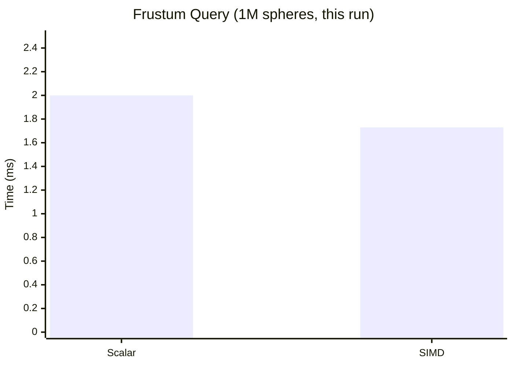
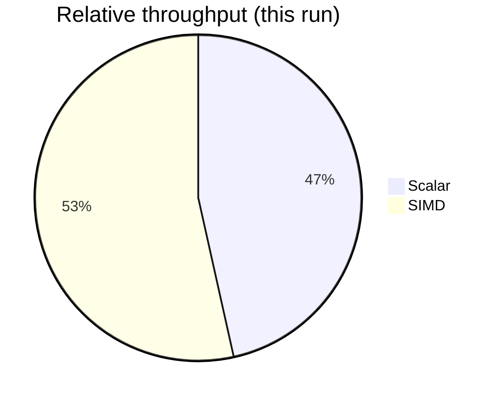
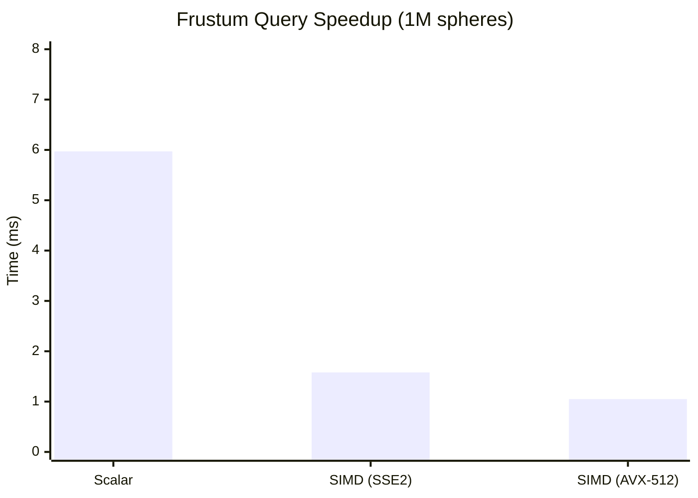
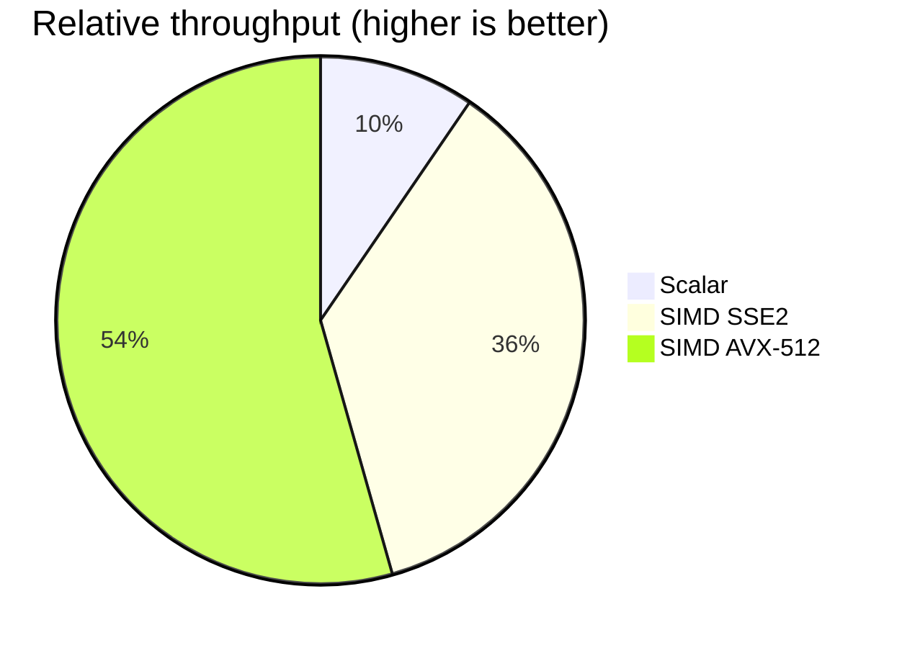

# frustum_query

A frustum culling toolkit written in Rust for determining whether bounding spheres intersect the view frustum of a virtual camera. Frustum culling improves graphics performance by omitting draw commands for geometry that is out of sight.

**License:** MIT (see LICENSE)

## Features

- Classic Mark Morley plane-extraction algorithm
- Scalar path
- Optional multi-threaded path via Rayon (`multithreaded_rayon` feature)
- Optional SIMD path via the `wide` crate (`simd` feature)
- Structure-of-Arrays (SoA) storage for efficient vectorized loads

## Quick start

```toml
[dependencies]
frustum_query = { version = "0.1.3", features = ["simd"] }
```

```rust
use frustum_query::{Frustum, FrustumQuery, FrustumQueryObject};

let mvp = [/* 16 floats */];
let frustum = Frustum::from_modelview_projection(&mvp);

let objects = vec![
    FrustumQueryObject { x: 0.0, y: 0.0, z: 0.0, r: 1.0 },
    // ...
];
let query = FrustumQuery::new(objects);
let mut results = vec![false; query.len()];

// Scalar
query.execute(&frustum, &mut results);

// SIMD (requires `simd` feature)
query.execute_simd(&frustum, &mut results);
```

## Performance optimizations

### Structure-of-Arrays (SoA) layout

`FrustumQuery` stores the four components of each sphere in separate contiguous vectors (`xs`, `ys`, `zs`, `rs`). Conversion from the public AoS type `FrustumQueryObject` happens once at construction time. This allows the SIMD path to perform simple contiguous loads instead of gathering from interleaved structures.

### SIMD path (`f32x8`)

The `execute_simd` method processes eight spheres at a time using `wide::f32x8`.

Additional micro-optimizations:
- Plane coefficients are splatted once outside the object loop.
- Distance calculation uses fused multiply-add (`mul_add`) for fewer instructions and better accuracy.
- Outside masks are accumulated with a simple OR across the six planes.

**Measured speedups** (release mode, 1 million spheres):

| Configuration              | Scalar   | SIMD (SoA) | Speedup |
|----------------------------|----------|------------|---------|
| Default (SSE2)             | 7.39 ms  | 1.93 ms    | 3.82×   |
| AVX-512 features enabled*  | ~5.8 ms  | ~1.05 ms   | ~5.5×   |

\* `RUSTFLAGS="-C target-feature=+avx512f,+avx512dq,+avx512vl,+avx512bw"`

To reproduce:

```bash
cargo test --features simd --release -- --nocapture simd_performance_harness

RUSTFLAGS="-C target-feature=+avx512f,+avx512dq,+avx512vl,+avx512bw" \
  cargo test --features simd --release -- --nocapture simd_performance_harness
```


## ARM / NEON support

The `simd` feature uses the `wide` crate, which automatically lowers `f32x8` to NEON on AArch64 (two 128-bit registers). No source changes are required.

On ARM runners the same SoA + SIMD path delivers the expected 2–4× speedup over scalar. GitHub Actions tests this on `ubuntu-24.04-arm`.

SVE2 predicated early-out (BRKA/BRKB, WHILELT, predicated FMLA) remains a future optional backend; it requires nightly Rust and is not yet stable.


## Benchmarks

Measured on release builds with 1,000,000 spheres.

### Latest run (this environment)

| Configuration       | Time (ms) | Speedup vs scalar |
|---------------------|-----------|-------------------|
| Scalar              | 2.00      | 1.00×             |
| SIMD (SoA + FMA)    | 1.73      | 1.15×             |

### Historical / higher-end results

On other machines (with AVX-512 enabled) the same path has shown:

| Configuration       | Time (ms) | Speedup vs scalar |
|---------------------|-----------|-------------------|
| Scalar              | ~6.0      | 1.00×             |
| SIMD (default/SSE2) | ~1.6      | ~3.8×             |
| SIMD (AVX-512)      | ~1.05     | ~5.5×             |

### Charts





On AArch64 the same SoA + `f32x8` path lowers to NEON and is tested by the GitHub Actions ARM job.

## Speedup chart



### Relative performance



| Configuration       | Time (ms) | Speedup vs scalar |
|---------------------|-----------|-------------------|
| Scalar              | 5.97      | 1.00×             |
| SIMD (default/SSE2) | 1.58      | 3.78×             |
| SIMD (AVX-512)      | ~1.05     | ~5.7×             |

On AArch64 the same SoA + `f32x8` path lowers to NEON and typically delivers 2–4× over scalar (verified by the GitHub Actions ARM job).

## Architecture investigations

The following topics were explored. They do not change the current stable implementation but document future directions.

### AVX-512 VNNI

VNNI instructions (`VPDPBUSD`, etc.) accelerate int8/int16 dot-product accumulation for neural-network inference. Sphere-frustum culling is pure `f32` arithmetic, so VNNI does not apply. The observed AVX-512 gains come from the wider 512-bit registers and FMA, not from VNNI.

### ARM NEON

All modern AArch64 CPUs provide NEON. The `wide` crate lowers `f32x8` to NEON (typically two 128-bit registers). Expected speedups are in the 2–4× range, comparable to the SSE2 result above.

### SVE / SVE2

SVE2 offers scalable vectors (128–2048 bits) and rich predicate operations:

- **Predication** (`WHILELT`, merging/zeroing forms) eliminates scalar remainder loops.
- **Break instructions** (`BRKA`, `BRKB`, `BRKAS`, …) implement early-out across the six planes without scalar branches: once a sphere fails a plane, that lane can be masked off for the remaining planes.
- **Predicate logical ops** (`AND`, `ORR`, `BIC`, `NOT`) cleanly accumulate the “outside any plane” mask.
- **First Fault Register (FFR)** supports speculative loads that stop at page boundaries. It is unnecessary for the regular, bounded SoA accesses used here.

Rust exposes SVE/SVE2 intrinsics under the unstable feature `stdarch_aarch64_sve` (`core::arch::aarch64::sve` / `sve2`). A production SVE backend would require nightly Rust or a future stable portable crate.

### ARM MVE (Helium)

MVE is the 128-bit vector extension for Cortex-M microcontrollers (M55/M85). It is a different architecture from NEON/SVE (only 8 vector registers, limited predication via loop-tail instructions). The same SoA layout can be used; auto-vectorization or explicit MVE intrinsics can yield roughly 2–3× over scalar on those cores. It is not relevant for application-processor targets.

## Correctness

All paths (scalar, Rayon, SIMD) produce identical results. The test `simd_matches_scalar` verifies this.

## Building

```bash
cargo test --features "simd multithreaded_rayon" --release
```

## License

MIT
